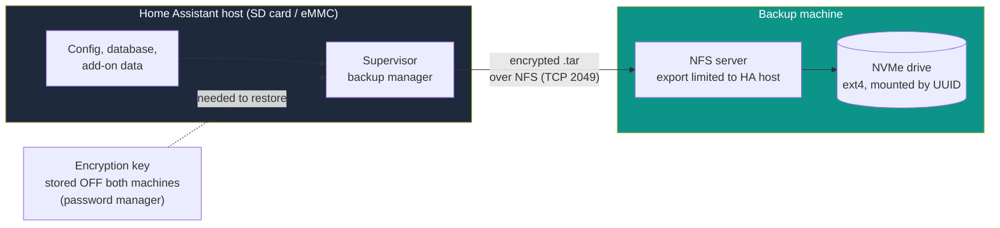
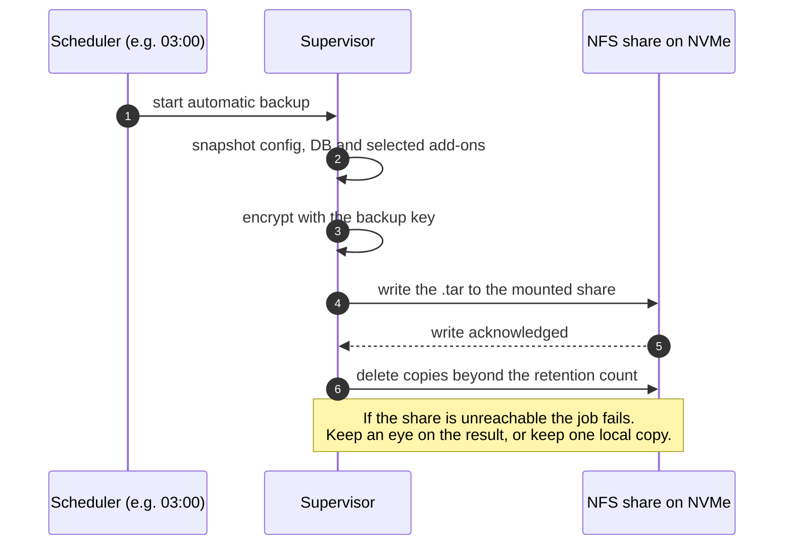
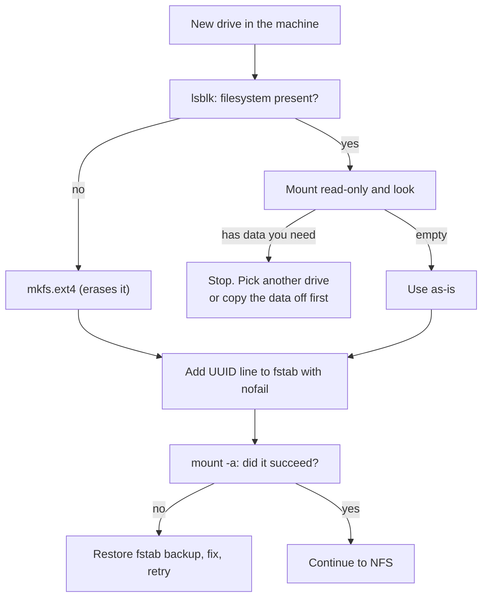
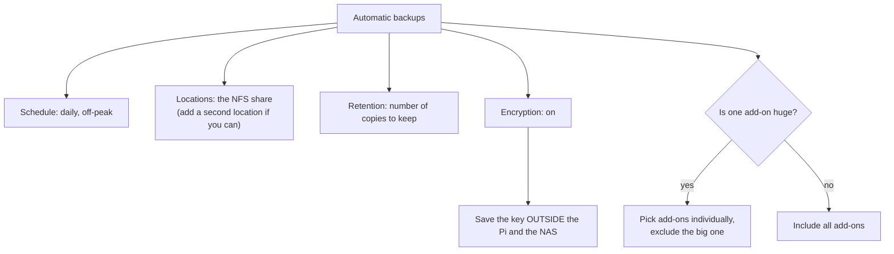
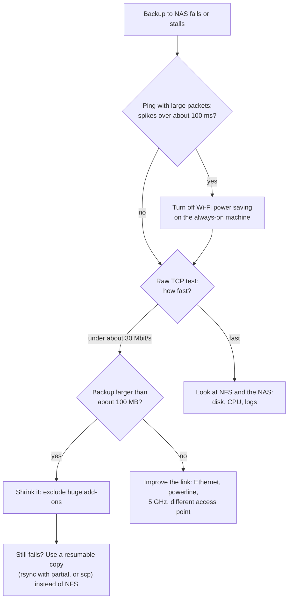

# NVMe + NFS Backup Target for Home Assistant (Pi, SD Card or Small Hub)

Home Assistant OS runs well on an SD card or small eMMC, and those are the media most
likely to fail. This guide turns a spare NVMe drive in another machine (for example an
AI box or a small server) into an automatic, encrypted backup target for Home Assistant
over NFS, and records the pitfalls found when the link between the two machines is Wi-Fi.

> Placeholders: `<HA_IP>` is the Home Assistant host, `<NAS_IP>` is the machine that owns
> the drive, `<DISK_UUID>` is the drive's filesystem UUID. Replace them with your values.

## Contents

1. [Architecture](#architecture)
2. [What the backup contains (and why size matters)](#what-the-backup-contains-and-why-size-matters)
3. [Step 1: Prepare the drive](#step-1-prepare-the-drive)
4. [Step 2: Export it over NFS](#step-2-export-it-over-nfs)
5. [Step 3: Add it to Home Assistant](#step-3-add-it-to-home-assistant)
6. [Step 4: Schedule, retain and encrypt](#step-4-schedule-retain-and-encrypt)
7. [Step 5: Verify, then test a restore](#step-5-verify-then-test-a-restore)
8. [If the link is Wi-Fi](#if-the-link-is-wi-fi)
9. [Troubleshooting](#troubleshooting)
10. [Security notes](#security-notes)

## Architecture



The nightly flow:



## What the backup contains (and why size matters)

A "full" backup is Home Assistant core, its database and every add-on's data. Inspect it
before you design around it, because one add-on usually dominates:

```bash
# The outer archive is a plain tar of per-component archives.
tar tvf <backup-file>.tar | awk '{printf "%.1f MB  %s\n", $3/1048576, $6}' | sort -rn | head
```

In one real setup, a 231 MB backup was 201 MB from a single network-controller add-on, 26 MB
from Home Assistant itself and under 4 MB for everything else. Excluding that add-on from
the nightly backup (and backing it up separately, less often) shrank the nightly file to
about 29 MB. That single change is what made backups over Wi-Fi reliable.

## Step 1: Prepare the drive

**Look first. Do not format a drive you have not inspected.**

```bash
lsblk -o NAME,SIZE,FSTYPE,LABEL,MOUNTPOINT,MODEL
```

If the drive already has a filesystem, mount it **read-only** and look at what is on it:

```bash
sudo mkdir -p /mnt/inspect
sudo mount -o ro,noexec,nosuid /dev/<PARTITION> /mnt/inspect
sudo ls -la /mnt/inspect && sudo du -sh /mnt/inspect/* 2>/dev/null
sudo umount /mnt/inspect && sudo rmdir /mnt/inspect
```

Only if the drive is new or you are certain it is empty, create the filesystem (this
**erases the partition**):

```bash
sudo mkfs.ext4 -L Data /dev/<PARTITION>      # destructive
```

Mount it permanently **by UUID** with `nofail`, so a missing drive can never stop the
machine from booting:

```bash
sudo blkid /dev/<PARTITION>                  # note the UUID
sudo cp /etc/fstab /etc/fstab.bak-$(date +%Y%m%d)
echo "UUID=<DISK_UUID> /mnt/data ext4 defaults,nofail 0 2" | sudo tee -a /etc/fstab
sudo mkdir -p /mnt/data
sudo mount -a && findmnt /mnt/data           # mount -a validates the new line now
```

Create the backup folder, owned by the user the NFS server will map writes to:

```bash
id <user>                                    # note the uid and gid (often 1000)
sudo mkdir -p /mnt/data/ha-backups
sudo chown <user>:<user> /mnt/data/ha-backups
sudo chmod 750 /mnt/data/ha-backups
```



## Step 2: Export it over NFS

```bash
sudo apt-get install -y nfs-kernel-server
sudo mkdir -p /etc/exports.d                 # may not exist on a fresh install
echo "/mnt/data/ha-backups <HA_IP>(rw,sync,no_subtree_check,all_squash,anonuid=<uid>,anongid=<gid>)" \
  | sudo tee /etc/exports.d/ha-backups.exports
sudo systemctl enable --now nfs-server
sudo exportfs -ra && sudo exportfs -v
ss -ltn | grep ':2049'
```

What the options do:

| Option | Meaning |
|---|---|
| `<HA_IP>` | Only that client may mount the share. Use one address, not a whole network |
| `rw,sync` | Writes are acknowledged only once durable |
| `all_squash` + `anonuid/anongid` | Every remote user is mapped to your chosen local user, so no remote root |
| `no_subtree_check` | Avoids a class of stale-handle problems |

Avoid `no_root_squash`. Home Assistant's backup process runs as root, and `all_squash`
maps it safely to an unprivileged owner of the folder.

Ubuntu does not enable a firewall by default; if you run one, allow TCP 2049 from `<HA_IP>`
only.

## Step 3: Add it to Home Assistant

In the UI: **Settings, System, Storage, Add network storage**.

| Field | Value |
|---|---|
| Name | letters, digits and underscores only, for example `backup_nas` |
| Usage | Backup |
| Type | NFS |
| Server | `<NAS_IP>` |
| Remote share path | `/mnt/data/ha-backups` |

The same can be done through the Supervisor API (`POST /mounts` with `usage: backup`,
`type: nfs`, `server`, `path`). After saving, the share appears as a backup location in
Settings, System, Backups.

## Step 4: Schedule, retain and encrypt

In Settings, System, Backups, configure automatic backups:



Guidance:

- **Encrypt.** Backups contain tokens, passwords and Wi-Fi credentials in the clear
  otherwise. The key is shown once; put it in a password manager. If the Home Assistant
  host dies and the key was stored only on it, the backups are unreadable.
- **Retention** is per location. Seven daily copies of a 30 MB backup is only 210 MB.
- **Exclude huge, rarely changing add-ons** and back them up on their own schedule using
  their built-in export.
- **Do you still want a local copy?** A local copy survives the NAS being down, but uses
  SD-card space and takes extra writes. If you remove the local location, a failed
  transfer leaves *no* backup, so watch the job results.

## Step 5: Verify, then test a restore

1. Run **Create backup** manually once, choosing the NFS location.
2. On the NAS, check the file arrived and its size matches what Home Assistant reports:

   ```bash
   ls -la /mnt/data/ha-backups
   ```
3. Confirm the Home Assistant host kept **no** copy if you chose NAS-only, and note the
   free space it reports.
4. Do a restore test of a *partial* backup (one add-on or the configuration) on a test
   instance if you can. An untested backup is a hope, not a backup.

Backups on the same network, in the same building, do not protect against fire, theft or
a power surge that takes both machines. Copy the newest backup somewhere else
occasionally (another site or cloud storage, encrypted).

## If the link is Wi-Fi

Ethernet is strongly preferred. If you cannot run a cable, expect these problems.

**Symptoms**

- The backup job fails near the end, often after tens of megabytes.
- The Home Assistant host's kernel log shows `nfs: server <NAS_IP> not responding, timed out`.
- The partial file on the NAS disappears.
- A stalled NFS mount may slow other work on the Home Assistant host while it waits.

**What was measured in one real setup**

| Check | Finding |
|---|---|
| Latency, large pings, Wi-Fi power saving **on** | average 60 ms, worst 462 ms |
| Same, power saving **off** | average 11 ms, worst 27 ms |
| Raw TCP, 300 MB from the hub to the NAS (no NFS) | about 18 Mbit/s, about 130 s |
| Backup of 231 MB over NFS | failed twice, near 130-170 MB |
| Backup of 29 MB over NFS | succeeded, encrypted, no local copy |

The signal itself was good (about -53 dBm, 100+ Mbit/s link rates). Both machines were
clients of the **same 2.4 GHz access point**, so every byte crossed the same busy radio
twice. NFS is not built for a link that stalls; a sustained transfer hits its time-out.



Useful commands:

```bash
# 1. Latency under load (run from the Home Assistant host's shell)
ping -c 25 -s 1400 -q <NAS_IP>

# 2. Raw bulk throughput, no NFS involved
#    On the NAS:   nc -l 5001 > /dev/null
#    On the HA host:
dd if=/dev/zero bs=1M count=300 | nc <NAS_IP> 5001

# 3. Turn Wi-Fi power saving off now (NetworkManager)...
sudo iw dev <wifi-interface> set power_save off
# ...and keep it off after reboot:
printf "[connection]\nwifi.powersave = 2\n" | sudo tee /etc/NetworkManager/conf.d/99-wifi-powersave-off.conf
sudo nmcli general reload conf
```

Notes:

- Wi-Fi power saving mainly adds latency. On a mains-powered machine the power saved is
  small, and the added latency also slows any voice or API traffic to that machine, so
  leaving it off is usually the better trade. You can toggle it on a schedule with a
  systemd timer if you prefer, but it was not what fixed the backup failures in the case
  above; the backup size was.
- If both devices must use Wi-Fi, putting them on different access points or bands helps
  more than any software setting. Powerline adapters or a small Wi-Fi-to-Ethernet bridge
  give the NAS a wired path when no switch port is nearby.
- As a last resort, move the transfer off NFS: let the NAS *pull* the finished backup with
  a resumable tool and verify a checksum, then delete the source copy.

## Troubleshooting

| Symptom | Likely cause | Fix |
|---|---|---|
| `tee: /etc/exports.d/...: No such file or directory` | The directory is missing on a fresh install | `sudo mkdir -p /etc/exports.d` |
| `mount -a` error after editing fstab | Typo in the new line | Restore the `.bak` copy and retry |
| `findmnt --verify` warns about `/dev/root` | Unrelated vendor line, not yours | Ignore if your line verifies |
| Home Assistant cannot add the share | Wrong path, or client IP not in the export | Check `exportfs -v` and the share path |
| Permission denied writing | Folder not owned by the mapped user | `chown` to the `anonuid` user |
| `nfs: server not responding` | Link stalls (see the Wi-Fi section) | Shrink backups, fix the link |
| Backup works, restore asks for a key | Encryption key lost | Recover it from your password manager; keep two copies |
| Disk fills up | Retention too high or huge add-on included | Lower copies, exclude the big add-on |

## Security notes

- **Export to one client only** and use `all_squash`. Never export to the whole LAN or
  with `no_root_squash`.
- **NFS is not encrypted on the wire.** That is acceptable on a trusted home LAN because
  the backups themselves are encrypted, which is why encryption should stay on.
- **Keep the key off both machines.** A backup and its key stored together is no
  protection at all.
- **Mind what is in a backup.** It holds long-lived tokens and credentials. Restrict the
  folder permissions on the NAS and avoid copying backups to unmanaged cloud folders.
- **Disable password SSH on the NAS** once key login works, and avoid leaving an
  unpassphrased private key on a laptop that has access to both machines.

## Related guides

- [Local voice assistant for Home Assistant on a Jetson](../genai/home-assistant-local-voice-assistant-jetson.md)
- [Secure Remote Access Patterns](secure-remote-access-patterns.md)
