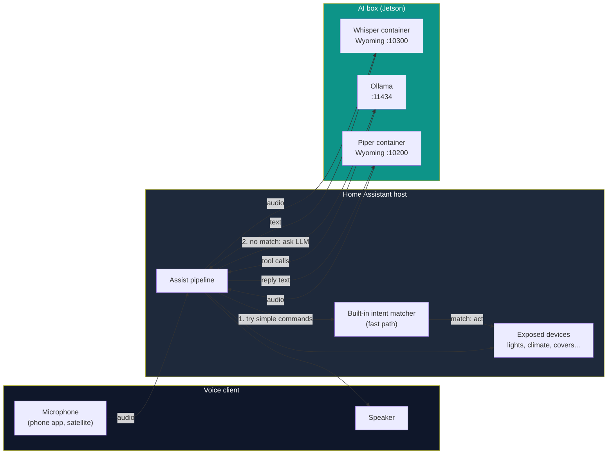
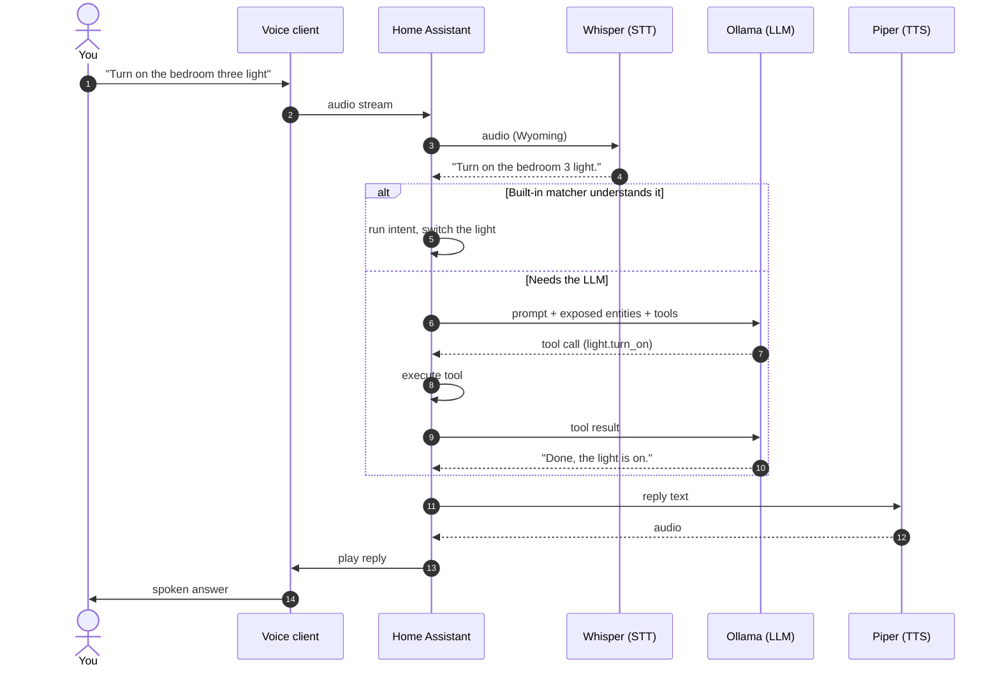
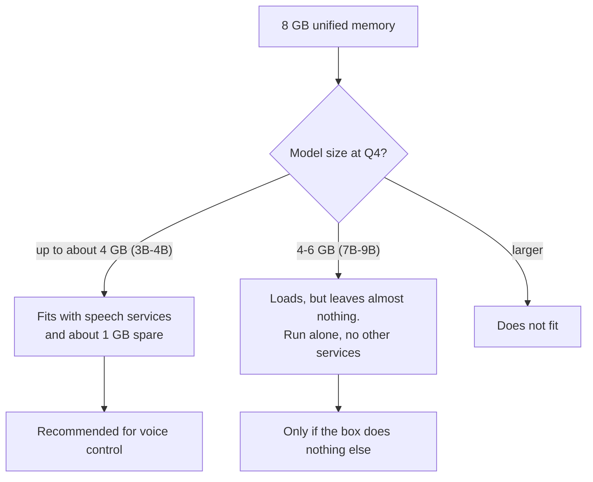
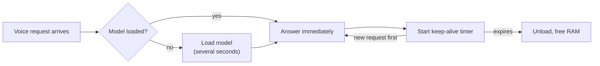
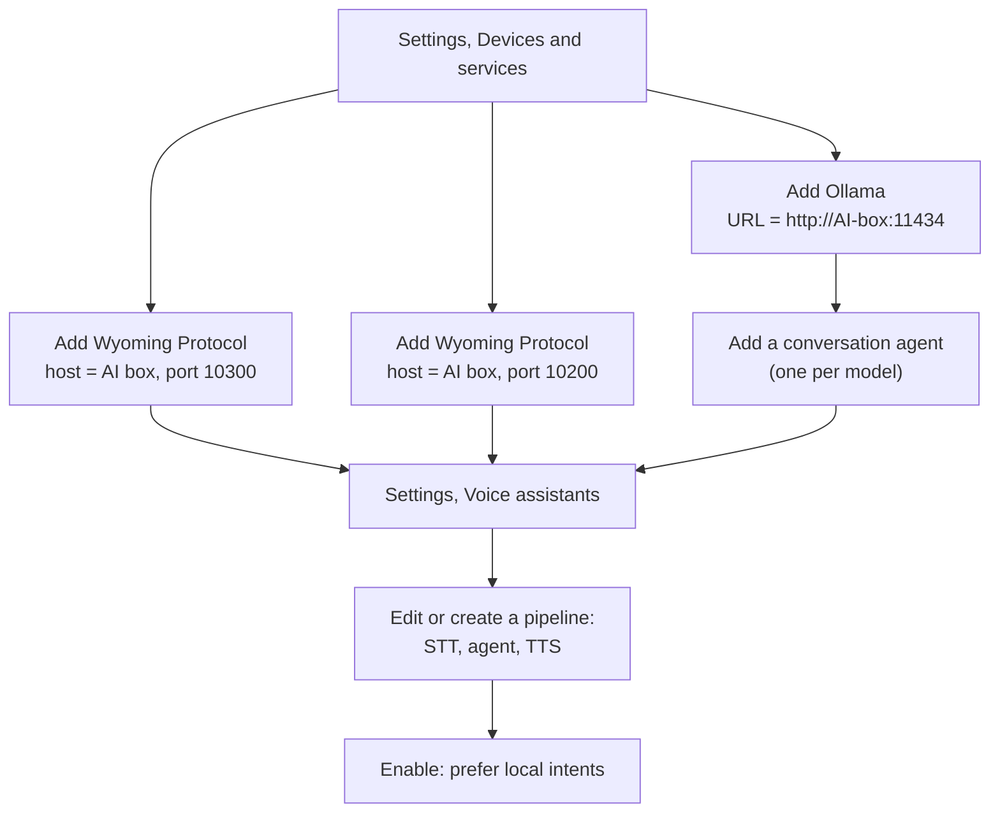
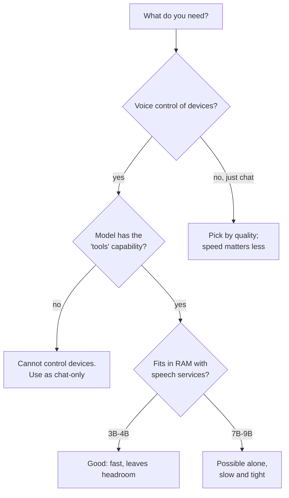

# Local Voice Assistant for Home Assistant on an NVIDIA Jetson (Whisper + Piper + Ollama)

A fully local voice assistant: speech-to-text (STT), a local LLM with device control, and
text-to-speech (TTS), all running on hardware you own. This guide uses an 8 GB Jetson
Orin Nano class board as the "AI box" and a Raspberry Pi (or any host) running Home
Assistant OS as the "hub", but the pattern applies to any small ARM or x86 box.

> Placeholders used throughout: `<JETSON_IP>` (the AI box's LAN address), `<HA_HOST>`
> (the Home Assistant host). Replace them with your own values. Nothing here requires
> exposing a service to the internet.

## Contents

1. [Architecture](#architecture)
2. [Memory budget (the real constraint)](#memory-budget-the-real-constraint)
3. [Step 1: Ollama on the AI box](#step-1-ollama-on-the-ai-box)
4. [Step 2: Speech services (Whisper and Piper)](#step-2-speech-services-whisper-and-piper)
5. [Step 3: Connect Home Assistant](#step-3-connect-home-assistant)
6. [Step 4: Expose devices and teach it names](#step-4-expose-devices-and-teach-it-names)
7. [Step 5: Test each stage](#step-5-test-each-stage)
8. [Choosing a model](#choosing-a-model)
9. [Troubleshooting](#troubleshooting)
10. [Security notes](#security-notes)

## Architecture

Home Assistant's **Assist pipeline** chains four stages. Each stage is a pluggable
engine, which is why the heavy parts can live on a different machine from the hub.



The same flow for one spoken command:



**Why a fast path matters.** Enable "prefer local intents" on the pipeline. Simple
commands ("turn on the kitchen light", "is the door closed") are answered by Home
Assistant's own matcher in under a second and never touch the LLM. Only open-ended
questions pay the LLM's latency.

## Memory budget (the real constraint)

On a Jetson the CPU and GPU share one pool of RAM. An 8 GB board is comfortable for a
small model plus speech services, and uncomfortable for anything bigger.

Measured on one 8 GB Orin Nano class board (your numbers will differ):

| Component | Approx. RAM |
|---|---|
| Ollama runner, 3B model at 8k context | about 4.1 GB |
| Whisper container, `base-int8` model | about 0.4 GB |
| Piper container, medium voice | about 0.05 GB |
| Desktop session (if a GUI is running) | about 0.4 GB |
| OS and other services | remainder |



Tips that gave real headroom:

- Cap each container (`--memory 600m`) so one runaway process cannot starve the model.
- Prefer a headless boot target if you do not need the desktop.
- Context length costs memory: 8192 tokens is enough for a home-control prompt; 64k is not
  affordable alongside other services on 8 GB.

## Step 1: Ollama on the AI box

Install Ollama, then make it reachable from the hub and keep memory use predictable.

```bash
# Allow the hub to connect, keep one model resident, and one request at a time.
sudo systemctl edit ollama
```

```ini
[Service]
Environment="OLLAMA_HOST=0.0.0.0:11434"
Environment="OLLAMA_MAX_LOADED_MODELS=1"
Environment="OLLAMA_NUM_PARALLEL=1"
```

```bash
sudo systemctl daemon-reload && sudo systemctl restart ollama
ss -ltn | grep 11434          # expect *:11434, not 127.0.0.1:11434
```

Notes:

- `0.0.0.0` means "all interfaces". Ollama has **no authentication**, so keep it on a
  trusted LAN and do not port-forward it. See [Security notes](#security-notes).
- `OLLAMA_MAX_LOADED_MODELS=1` is what keeps an 8 GB board stable. Switching models then
  costs a few seconds to unload and load.
- Pull only models that report the **tools** capability if you want device control:

```bash
curl -s http://<JETSON_IP>:11434/api/tags | python3 -c \
 'import json,sys; [print(m["name"], m.get("capabilities")) for m in json.load(sys.stdin)["models"]]'
```

### Model keep-alive (the "TTL")

Ollama unloads an idle model after a timeout. Home Assistant lets you set this per
conversation agent as `keep_alive`:



| `keep_alive` | Effect | Use for |
|---|---|---|
| `-1` | Never unload | The one agent you use daily. Fast every time, always holds RAM |
| `300` (seconds) | Unload after 5 idle minutes | Secondary or experimental agents |
| `0` | Unload right after each reply | Memory-starved boxes; every request pays the load time |

With `OLLAMA_MAX_LOADED_MODELS=1`, only one model is resident anyway, so give `-1` to your
daily agent and a short value to the rest.

## Step 2: Speech services (Whisper and Piper)

Both services speak the **Wyoming** protocol, so Home Assistant sees them as ordinary
STT and TTS engines. Running them as plain Docker containers is simpler than add-ons and
keeps load off a small hub.

```bash
mkdir -p ~/wyoming/piper ~/wyoming/whisper

# TTS: bind to the LAN address only, cap memory, restart on boot.
docker run -d --name wyoming-piper --restart unless-stopped --memory 600m \
  -p <JETSON_IP>:10200:10200 -v ~/wyoming/piper:/data \
  rhasspy/wyoming-piper --voice en_US-lessac-medium

# STT: pick the model explicitly (see the note below).
docker run -d --name wyoming-whisper --restart unless-stopped --memory 700m \
  -p <JETSON_IP>:10300:10300 -v ~/wyoming/whisper:/data \
  rhasspy/wyoming-whisper --model base-int8 --language en
```

The images are multi-architecture, so the same command works on ARM. The first start
downloads the voice and model, so wait for the container to report healthy:

```bash
docker ps --format '{{.Names}} {{.Status}}'
docker logs --tail 3 wyoming-whisper     # look for "Ready"
```

**Always set the Whisper model explicitly.** In the Home Assistant Whisper add-on, the
default `auto` setting picked a 0.6-billion-parameter speech model on a small board. That
needs roughly 600 MB of RAM and a large download. On a 2 GB hub this most likely
contributed to swap pressure and a nearly full disk (inferred: uninstalling the two speech
add-ons freed about 2.5 GB). Choose a size yourself.

Rough speed on a CPU-only Jetson for short commands (single runs, synthetic speech, not a
benchmark):

| Where / model | Typical time per phrase |
|---|---|
| Small hub, `tiny` | 3-4 s |
| Jetson, `small-int8` | 4.3-4.8 s |
| Jetson, `base-int8` | 2.3-2.5 s |

`base-int8` was the best balance of accuracy and speed here. Larger models are more
accurate with accents and noise, but slower on CPU.

## Step 3: Connect Home Assistant



1. **Wyoming (STT and TTS).** Add the integration twice: host `<JETSON_IP>`, port `10300`
   (Whisper) and again with port `10200` (Piper). You get one `stt.*` and one `tts.*`
   entity.
2. **Ollama.** Add the integration with `http://<JETSON_IP>:11434`.
3. **Conversation agent.** Add a conversation agent under the Ollama integration. The
   fields that matter (UI labels vary by version; the underlying field names are `model`,
   `llm_hass_api`, `num_ctx`, `max_history`, `keep_alive` and `think`):

   | Field | Suggested value | Why |
   |---|---|---|
   | Model | a tools-capable model | needed for device control |
   | Control Home Assistant | `Assist` | lets the model call tools |
   | Context window | `8192` | enough for a home prompt, affordable in RAM |
   | Max history | `20` | bounds the prompt growth |
   | Keep alive | `-1` daily agent, `300` others | see [keep-alive](#model-keep-alive-the-ttl) |
   | Think | off | thinking models are slow for voice |

   A model without tool support (for example some small chat models) must have **Control
   Home Assistant** turned off or Home Assistant reports that tools are unsupported. It
   can still chat, but cannot operate devices.
4. **Pipeline.** Under Settings, Voice assistants, set the pipeline's conversation agent,
   speech-to-text engine and text-to-speech engine and voice, and turn on **Prefer
   handling commands locally**.

> If a pipeline still points at the built-in "Home Assistant" agent or has no STT engine,
> typed chat may work while voice silently does nothing. Check all three engines.

## Step 4: Expose devices and teach it names

Assist can only see entities you expose.

- Settings, Voice assistants, **Expose**: select the devices you are willing to let a
  voice (and an LLM) control.
- Add **aliases** to anything people name differently from its label. The most common
  failure: you say "bedroom three" and the recogniser writes **"bedroom 3"**, or the
  reverse. Add both spellings as aliases on the area and on the entity.
- If a built-in query phrase fails ("is the garage door open"), add an alias that matches
  how you say it (for example the exact device name). The LLM agent usually handles it
  anyway.
- Be deliberate with high-impact devices (garage doors, locks, alarms). Anything exposed
  can be triggered by anyone who can speak to or type into Assist.
- Do not expose hundreds of diagnostic sensors. A long entity list inflates the prompt,
  slows every LLM answer and hurts a small model's accuracy. Expose controllable devices
  plus a short list of useful sensors.

## Step 5: Test each stage

Test stages separately so you know which one is broken.

**LLM, no voice:**

```bash
curl -s http://<JETSON_IP>:11434/api/chat -d '{
  "model":"<MODEL>","stream":false,
  "options":{"num_predict":24,"num_ctx":2048},
  "messages":[{"role":"user","content":"Reply with exactly: ready"}]}'
```

The response includes `load_duration` (model load) and `eval_duration` (generation).
The first call after idle includes the load.

**STT with real audio** (macOS example; any 16 kHz mono WAV works):

```bash
say -v Samantha -o t.aiff "Is the garage door closed"
afconvert -f WAVE -d LEI16@16000 -c 1 t.aiff t.wav

curl -s -X POST http://<HA_HOST>:8123/api/stt/<STT_ENTITY_ID> \
  -H "Authorization: Bearer <TOKEN>" \
  -H "X-Speech-Content: format=wav; codec=pcm; sample_rate=16000; bit_rate=16; channel=1; language=en" \
  --data-binary @t.wav
```

**Text understanding (no audio, read-only question):** use Developer tools, Assist, or
the `conversation/process` WebSocket call, and ask a *question*, not a command, so
nothing in the house changes.

**TTS:** request a short phrase through the Home Assistant TTS API and confirm you get
audio bytes back.

Keep API tokens out of chat logs, shell history and screenshots. Use a file with
restrictive permissions, and revoke the token when you are done.

## Choosing a model



Guidance rather than a ranking, because it depends on your hardware and language:

- For **device control**, a 3B tools-capable model was fast (about 27 tokens/s on an
  8 GB board once loaded) and leaves room for speech services.
- For **general conversation**, 4B-class models with larger context give better answers
  per GB. 7B-9B models load on 8 GB but leave little else, and are noticeably slower.
- Context window claims on model cards are not free: the KV cache grows with context.
- Check licences if it matters: "open weights" does not always mean an OSI-approved
  open-source licence.

You can run several agents (one per model) and one pipeline per agent, then pick by
voice device. With `OLLAMA_MAX_LOADED_MODELS=1`, only the active one uses memory.

## Troubleshooting

| Symptom | Likely cause | Fix |
|---|---|---|
| Typed chat works, voice does nothing | Pipeline has no STT engine, or no engine reachable | Set STT and TTS in the pipeline; test each stage |
| Replies in text but no spoken answer | TTS engine points at a cloud service you do not have | Switch TTS to the local Piper entity |
| Assist ignores your own LLM | Pipeline still uses the built-in agent | Change the pipeline's conversation agent |
| "I can't control anything" | No entities exposed | Expose devices in Voice assistants |
| Says it does not know "bedroom 3" / "three" | Number spelling mismatch | Add both spellings as aliases |
| Error that tools are unsupported | Model lacks tool calling | Turn off Control Home Assistant, or pick another model |
| Error about the thinking flag | Model does not support thinking | Turn Think off |
| Slow first answer, fast later | Model was unloaded | Raise `keep_alive` for that agent |
| Box swaps or freezes | Model plus containers exceed RAM | Smaller model or context; cap containers; disable the GUI |
| Hub runs out of disk after installing speech add-ons | Large auto-selected Whisper model and images | Pin a small model, or run the services on the AI box |
| Latency spikes on Wi-Fi | Wi-Fi power saving on a mains-powered box | `sudo iw dev <iface> set power_save off`; persist via NetworkManager `wifi.powersave = 2` |

Scripting gotchas if you automate setup through the Home Assistant API:

- Config-flow REST endpoints live under `/api/config/config_entries/flow`, not
  `/api/config_entries/flow`.
- Adding a conversation agent makes the Ollama integration reload. The *next* form you
  open can become invalid. Wait several seconds between additions and retry on
  "Invalid flow".
- The `ha apps` command line in recent Home Assistant OS has no `options` sub-command.
  Change add-on options through the Supervisor API or the UI.

## Security notes

- **Bind to the LAN only.** Ollama and the Wyoming services have no authentication.
  Publish container ports on the LAN address (`-p <JETSON_IP>:10300:10300`), keep the box
  off the public internet, and use a VPN overlay for remote access.
- **Least privilege for exposure.** Decide per device whether voice control is
  acceptable. A voice assistant is another way to operate anything you expose.
- **Treat tokens like passwords.** Prefer a restricted file over pasting into chats or
  terminals, and revoke temporary tokens afterwards.
- **Prompt injection.** A model that can call tools can be steered by text it reads. Keep
  the tool set small and avoid exposing destructive actions.
- **Backups.** The pipeline, agents and aliases live in Home Assistant's `.storage`
  folder, which is not part of your YAML. See the companion guide
  [NVMe + NFS backup target for Home Assistant](../devops/home-assistant-backup-nvme-nfs.md).

## Related guides

- [Bridging Cloud AI Agents to Home-Network Devices (Tailscale + Ollama + Home Assistant)](tailscale-ollama-homeassistant-bridging.md)
- [LLM Inference Fundamentals](llm-inference-fundamentals.md)

## References

- Home Assistant documentation: Assist, Voice assistants, Ollama and Wyoming integrations.
- Ollama documentation: environment variables, tool calling, `keep_alive`.
- The `rhasspy/wyoming-whisper` and `rhasspy/wyoming-piper` container images.
