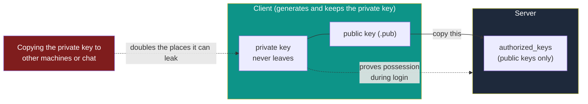
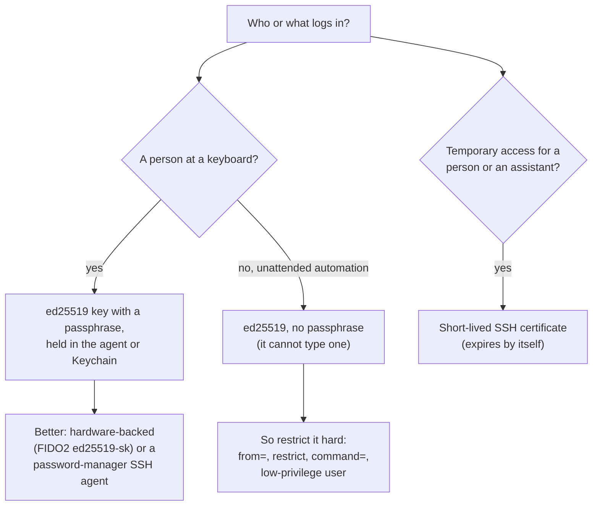
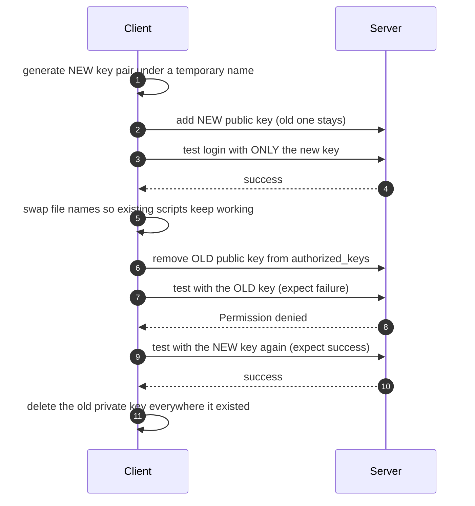
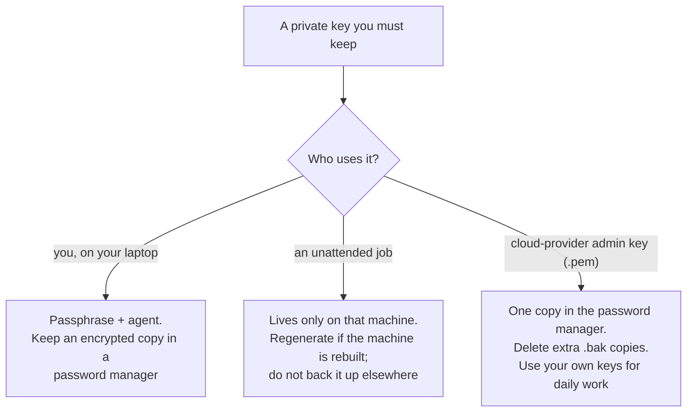

# SSH Key Hygiene and Safe Rotation

How to create, deploy, restrict, rotate and store SSH keys across a handful of machines
(laptop, home servers, cloud VMs, automation agents) without locking yourself out and
without leaving secrets scattered around. The rotation procedure here was exercised
end to end on a real set of machines, including a negative test that proves the old key
is dead.

> Placeholders: `<client>` is the machine that logs in, `<server>` is the machine being
> logged into, `<user>` is the account on the server, `<name>` is a key file name.

## Contents

1. [The one rule](#the-one-rule)
2. [Choosing a key type per use](#choosing-a-key-type-per-use)
3. [Generate on the client that will use it](#generate-on-the-client-that-will-use-it)
4. [Authorize with restrictions](#authorize-with-restrictions)
5. [Passphrases, the agent and client config](#passphrases-the-agent-and-client-config)
6. [Safe rotation procedure](#safe-rotation-procedure)
7. [Harden the servers](#harden-the-servers)
8. [Audit what is authorized](#audit-whats-authorized)
9. [Storing private keys](#storing-private-keys)
10. [Temporary access for people and AI assistants](#temporary-access-for-people-and-ai-assistants)
11. [Troubleshooting](#troubleshooting)

## The one rule

**A private key lives only on the machine that uses it. Servers only ever receive the
public half.**



Common anti-pattern: generating every key pair on your laptop and copying the private key
onto the machine that will use it. Now the secret exists in two places, and the laptop
copy has no purpose. Generate on the machine that logs in, copy only `.pub`, and verify.

If you inherited a private key and need its public half, derive it. This reveals nothing
secret:

```bash
ssh-keygen -y -f ~/.ssh/<name>
```

## Choosing a key type per use



Notes:

- ed25519 is small, fast and the modern default. RSA 3072+ is still acceptable if a
  system requires it.
- An unattended key with no passphrase is only as safe as the file permissions and the
  restrictions you give it. That is why the next section matters.

## Generate on the client that will use it

```bash
# A person: you will be prompted for a passphrase. -a raises the key-derivation rounds.
ssh-keygen -t ed25519 -a 100 -C "<purpose> <owner> <date>" -f ~/.ssh/<name>

# Automation on the machine that runs the job: empty passphrase by design.
ssh-keygen -t ed25519 -N "" -C "<client>-to-<server> <date>" -f ~/.ssh/<name>
```

- Put purpose, owner and date in the **comment** (`-C`). Months later it is the only way
  to tell keys apart in an `authorized_keys` file.
- Use one key per client-to-server relationship. If it leaks, you revoke one path.
- Permissions must be strict or SSH refuses the key: `~/.ssh` is `700`, private keys are
  `600`.

## Authorize with restrictions

Append the **public** key to `~/.ssh/authorized_keys` on the server (or use
`ssh-copy-id -i ~/.ssh/<name>.pub <user>@<server>`). For anything unattended, prefix the
line with restrictions:

```
from="<client-ip>",no-agent-forwarding,no-X11-forwarding ssh-ed25519 AAAA... <purpose> <owner> <date>
```

| Option | Effect |
|---|---|
| `from="addr,..."` | Only those source addresses may use the key |
| `restrict` | Turns off forwarding, pty, agent and X11 in one go; add back only what you need (for example `restrict,pty`) |
| `command="/path/to/script"` | The key can only run that one command |
| `permitopen="host:port"` | Limits port-forward targets |
| `no-agent-forwarding`, `no-X11-forwarding` | Safe defaults for almost everything |

Cautions learned the hard way:

- **`from=` only works if the server sees the real client address.** If the connection
  passes through a proxy, a container bridge or a NAT layer (for example an add-on that
  proxies a VPN), the server sees an internal address such as a Docker gateway, and a
  correct-looking `from=` will lock the client out. After the first successful login,
  print what the server saw and use *that* in the restriction:

  ```bash
  ssh <user>@<server> 'echo "${SSH_CONNECTION%% *}"'
  ```

  If it is an internal bridge address, `from=` cannot distinguish clients on that server,
  so rely on other controls.
- `restrict` disables port forwarding and pty. If a job tunnels or needs a terminal, use
  `no-agent-forwarding,no-X11-forwarding` instead.
- Prefer a **dedicated low-privilege account** over `root` or a user with passwordless
  `sudo`. An automation key with root is a root shell for whoever steals it.

## Passphrases, the agent and client config

Add a passphrase to an existing key and load it once per login session (macOS example):

```bash
ssh-keygen -p -f ~/.ssh/<name>                       # set or change the passphrase
ssh-add --apple-use-keychain ~/.ssh/<name>           # remember it in Keychain
```

```text
# ~/.ssh/config
Host *
    AddKeysToAgent yes
    UseKeychain yes
    IdentitiesOnly yes

Host <alias>
    HostName <server>
    User <user>
    IdentityFile ~/.ssh/<name>
```

- `IdentitiesOnly yes` stops the client offering every key it has to every host.
- Leave **agent forwarding off**. Use `ProxyJump` to hop through a bastion instead: a
  compromised jump host can use a forwarded agent.
- A passphrase-protected key only works for programs that can reach the loaded agent. That
  is a feature: unattended tools on your laptop lose access when you are logged out.

## Safe rotation procedure

The order is the whole point. **Add the new key, prove it works, only then remove the old
one, and finally prove the old one is dead.** Never remove first.



Commands (run on the client unless noted):

```bash
# 1. Generate under a temporary name, on the machine that uses it.
ssh-keygen -t ed25519 -N "" -C "<client>-to-<server> $(date +%F)" -f ~/.ssh/<name>.new

# 2. Authorize the NEW public key on the server. Leave the old key in place.
#    (append the .pub content to ~/.ssh/authorized_keys, with restrictions if possible)

# 3. Prove the new key works on its own.
ssh -i ~/.ssh/<name>.new -o IdentitiesOnly=yes -o BatchMode=yes <user>@<server> 'echo NEW_OK'

# 4. Swap names so existing scripts and configs that reference <name> keep working.
mv ~/.ssh/<name>     ~/.ssh/<name>.old
mv ~/.ssh/<name>.new     ~/.ssh/<name>
mv ~/.ssh/<name>.new.pub ~/.ssh/<name>.pub

# 5. On the server: remove the OLD public key line (match it by fingerprint, below).

# 6. Negative test: the old key must now fail.
ssh -i ~/.ssh/<name>.old -o IdentitiesOnly=yes -o BatchMode=yes <user>@<server> 'echo SHOULD_NOT_WORK'
#    expected: Permission denied (publickey)

# 7. Positive test again, with the real name.
ssh -i ~/.ssh/<name> -o IdentitiesOnly=yes -o BatchMode=yes <user>@<server> 'echo NEW_OK'

# 8. Only now delete every copy of the old private key (and confirm by fingerprint first).
ssh-keygen -lf ~/.ssh/<name>.old
```

Tips:

- Keep one separate session open, logged in with a key you are *not* rotating, until the
  new key is proven. If something goes wrong you still have a way in.
- If a service restarts to apply the change (for example a managed SSH add-on), the first
  connection attempt after the restart can be refused. Retry after a few seconds.
- Match keys by **fingerprint**, never by comment. Comments are free text and often wrong.

## Harden the servers

```bash
# Drop-in file, so you do not edit the distribution's main config.
sudo tee /etc/ssh/sshd_config.d/10-hardening.conf >/dev/null <<'EOF'
PasswordAuthentication no
KbdInteractiveAuthentication no
PermitRootLogin prohibit-password
PubkeyAuthentication yes
EOF
sudo sshd -t                       # validate before reloading
sudo systemctl reload ssh          # service name is "sshd" on some distributions
sudo sshd -T | grep -E 'passwordauthentication|permitrootlogin'
```

Only do this after key login works, and keep an existing session open while you test a
new one.

- Keep port 22 off the public internet. Restrict it in the cloud firewall or security
  group to your VPN range or fixed address, or reach the machine only over a VPN overlay.
- `AllowUsers <user>` limits which accounts may log in at all.

## Audit what is authorized

Run this on each server periodically. It prints a fingerprint for every key so you can
spot the ones you do not recognise:

```bash
while IFS= read -r line; do
  [ -z "$line" ] && continue
  case "$line" in \#*) continue;; esac
  echo "$line" | sed -E 's/^(from="[^"]*",|restrict,|no-[a-z0-9-]+,)*//' | ssh-keygen -lf - 2>/dev/null
done < ~/.ssh/authorized_keys
```

Compare against your own list: `ssh-keygen -lf ~/.ssh/<name>.pub` on each client. For every
unknown fingerprint, find which machine holds the matching private key before you remove
it, since an unfamiliar key is often a forgotten automation. To find out, derive the
fingerprint from private keys on the candidate machines:

```bash
ssh-keygen -y -f ~/.ssh/<name> | ssh-keygen -lf -
```

## Storing private keys



- **Never paste a private key into a chat, ticket, email or terminal transcript.** It is a
  password. Anything that can read that transcript can log in as you.
- Use a password manager's *SSH key* item type or a secure note. Many managers also offer
  an SSH agent that signs without exposing the key.
- Copy through the clipboard, not the screen, and clear it afterwards:

  ```bash
  pbcopy < ~/.ssh/<name>          # macOS: contents go to the clipboard, nothing is printed
  # paste into the password manager item, then:
  pbcopy < /dev/null              # clear the clipboard
  ```
- Cloud-provider keys (`.pem`, `.key`) are the **original administrator credentials**.
  Keep them out of everyday use and out of backups you do not control.
- If you keep any key file in a synced or backed-up folder, remember the backup is now a
  copy of the key too.

## Temporary access for people and AI assistants

Giving an assistant or contractor standing access is the risky pattern. Better options,
from best to adequate:

1. **A short-lived SSH certificate.** You sign their public key with a CA key you control.
   The certificate stops working by itself:

   ```bash
   ssh-keygen -s ~/.ssh/ca_key -I "temp-access" -n <user> -V +1d ~/.ssh/<name>.pub
   # server: TrustedUserCAKeys /etc/ssh/ca.pub
   ```
2. **Your own key, unlocked in your session.** The assistant can only act while you have
   the key loaded in the agent, so closing your laptop ends its access.
3. **A dedicated key with strong restrictions** (`from=`, `restrict`, a low-privilege
   user), created and authorized by *you*, and removed when the work is done.

Be aware that some AI tooling blocks an assistant from creating and authorizing its own
key on your machines. That is a sensible guardrail: access grants should be a human
decision, not something an assistant arranges for itself.

## Troubleshooting

| Symptom | Likely cause | Fix |
|---|---|---|
| `Permission denied (publickey)` with a correct key | Loose permissions, or the server's `authorized_keys` or home folder is group-writable | `chmod 700 ~/.ssh; chmod 600 ~/.ssh/authorized_keys`; fix the home folder |
| Works with `-i`, not without | Client offers other keys first, or `IdentityFile` missing | Set `IdentityFile` and `IdentitiesOnly yes` in `~/.ssh/config` |
| Worked until you added a passphrase | The key is no longer loaded in the agent | `ssh-add` it (macOS: `--apple-use-keychain`) |
| Locked out after adding `from=` | The server saw a proxy or bridge address, not the real client | Print `SSH_CONNECTION` after a good login and use that, or drop `from=` |
| `Connection closed` right after a service restart | The SSH service was restarting | Retry after a few seconds |
| New key refused although added | Key added to the wrong user or the wrong account's file | Check `whoami` on the server and that file's owner |
| `REMOTE HOST IDENTIFICATION HAS CHANGED` | The server was rebuilt or you reached a different host | Verify the new host key out of band before updating `known_hosts` |
| Cannot tell which key is which | Comments are unreliable | Compare fingerprints with `ssh-keygen -lf` |

## Related guides

- [Secure Remote Access Patterns](../devops/secure-remote-access-patterns.md)
- [Bridging Cloud AI Agents to Home-Network Devices](../genai/tailscale-ollama-homeassistant-bridging.md)
- [Secrets Management Strategies](../devops/kubernetes/secrets-management-strategies.md)

## References

- OpenSSH manual pages: `ssh-keygen(1)`, `sshd(8)`, `sshd_config(5)`, `ssh_config(5)`,
  and the "AUTHORIZED_KEYS FILE FORMAT" section of `sshd(8)`.
